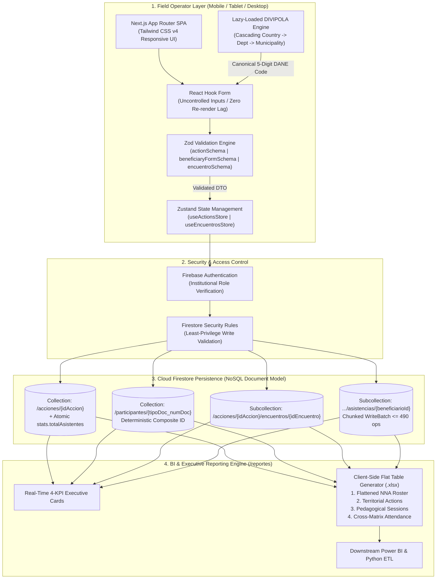
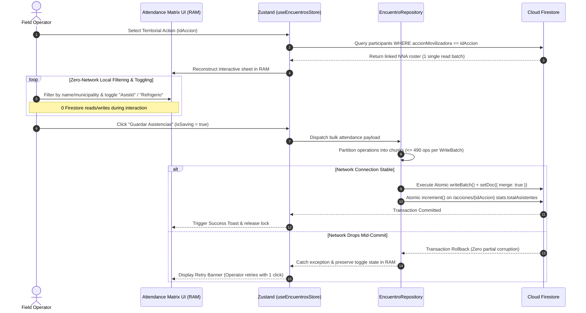

# LATIDO — Source-Level Data Governance, Territorial Characterization & Analytics Platform


> **Live Production Web App:** [https://icbf-sistema.web.app/login](https://icbf-sistema.web.app/login)  
> **Lead Architect & Developer:** Victor Manuel Orjuela Castaño — *Directorate of Childhood & Adolescence (ICBF)*  
> **Security & IP Disclosure:** Because LATIDO processes sensitive demographic records of minors (NNA) under Colombian data protection laws (*Ley 1581 / Ley 1098*), the full repository and `.env` keys remain privately hosted within the institution. This public repository serves as my **Engineering Case Study, System Specification, and Data Governance Architecture Showcase**.

---

## 1. Why I Built LATIDO (The Real-World Problem)

Working inside the Data & Information Management team at the **Colombian Institute of Family Welfare (ICBF)**, I kept running into the exact same operational wall: **you cannot fix broken data exclusively with downstream SQL scripts if the upstream capture mechanism is chaos.**

Across Colombia's 32 departments, regional psychosocial and community teams constantly execute preventive territorial interventions (*Acciones Movilizadoras* — community workshops, recruitment prevention, youth roundtables). However, because these agile field interventions are not tied to rigid administrative operator contracts, they **cannot be logged into the legacy *Cuéntame* mission system**.

### What was happening before LATIDO:
1. **Invisible Impact:** Field teams tracked thousands of children and adolescents (NNA) on paper attendance sheets and ad-hoc Excel files.
2. **Dirty Upstream Data:** Free-text municipality names (*"Bogota"*, *"Bogotá D.C."*, *"Bta"*), corrupted document numbers, adult ages accidentally logged as minors, and duplicate registrations across regional branches.
3. **Consolidation Bottlenecks:** My team spent days manually cleaning, deduplicating, and merging regional spreadsheets just to answer basic executive questions about territorial coverage.

**My Approach:** Instead of building another script to clean broken spreadsheets after the fact, I architected and deployed **LATIDO**—a lightweight, serverless Single-Page Application (SPA) that moves data validation directly to the moment of capture (**Data Quality at the Source**) and exports pre-flattened, audit-ready `.xlsx` data marts for **Power BI** and Python ETL pipelines.

---

## 2. End-to-End System Architecture (Feature-Sliced Design)

I structured the frontend following **Feature-Sliced Design (FSD)** principles to keep domain logic, validation contracts, and Firestore repositories strictly decoupled from UI components.



---

## 3. Deep Dive: Solving Field Operations with Data Engineering

### 3.1. Shifting Quality Left: Multi-Step Reactive Validation (`CU-02`)
Field operators fill out a dense demographic characterization survey for each minor. If a 40-field form re-renders on every keystroke on a low-end tablet in a rural municipality, the browser freezes.
* **Render Optimization:** I paired `React Hook Form` with modular `Zod` schemas (`identidadSchema` -> `caracterizacionSchema` -> `beneficiaryFormSchema`). Validation runs per step, blocking tab progression until the current domain contract is satisfied.
* **Computed Age Guardrails:** The schema dynamically calculates exact age from `fechaNacimiento` against the server/client date, strictly rejecting records where `age >= 18` or dates set in the future.
* **Dynamic Differential Logic:** Form state observers conditionally mount specialized capture blocks for ethnic self-recognition (*Indígena, Afrocolombiano, Raizal, Palenquero, Rrom*), disability support matrices, peasant (*campesinado*) organizations, and non-Colombian migration documents (*PEP, PPT, VISA*).
* **Deterministic Deduplication (`findByDocument`):** Before committing a new participant, `BeneficiaryRepository` checks for existing composite keys (`${tipoDocumento}_${numeroDocumento}`), eliminating duplicate NNA registrations at the database level.

### 3.2. Eradicating Geographic Noise via DANE DIVIPOLA (`CU-01` & `CU-02`)
In analytics, free-text location fields are a nightmare. In LATIDO, users never type a department or municipality name:
* **Asynchronous Lazy Loading:** Static low-volume catalogs (document types, gender, ethnic groups) load in memory, while heavy geographic catalogs load asynchronously on demand (`Country -> Department -> Municipality`).
* **Foreign Birthplace Rule:** If an operator selects a birth country other than Colombia, the form engine dynamically bypasses Colombian DANE department/municipality locks to prevent false geographic attribution.
* **Canonical Binding:** Every record stores the official 5-digit **DANE DIVIPOLA** numeric string (`idUbicacion`), making downstream choropleth mapping in **Power BI** instantaneous.

### 3.3. Resilient Attendance Sheets & Chunked `WriteBatch` Transactions (`CU-03`)
Taking attendance for 100+ kids in the field over unstable cellular data is where most web apps fail. If an app fires a database write every time the user toggles a checkbox, it burns through Firestore quotas and leaves half-saved corrupt states when the signal drops.

Here is how I engineered the attendance module (`/encuentros`) to be bulletproof:



---

## 4. Technical Traceability Matrix

| Use Case | Route | Core Actor | Validation Contract (Zod) | Repository / Store | Firestore Target Path |
| :--- | :--- | :--- | :--- | :--- | :--- |
| **CU-01: Register Mobilizing Action** | `/acciones` | Regional Operator / ICBF Admin | `actionSchema` | `ActionRepository` / `useActionsStore` | `acciones/{idAccion}` |
| **CU-02: Characterize & Link NNA** | `/beneficiarios` | Psychosocial Agent / Field Registrar | `identidadSchema` + `caracterizacionSchema` (`beneficiaryFormSchema`) | `BeneficiaryRepository` | `participantes/{tipoDoc_numDoc}` |
| **CU-03: Session & Attendance Matrix** | `/encuentros` | Community Facilitator | `encuentroSchema` + `asistenciaEncuentroSchema` | `EncuentroRepository` / `useEncuentrosStore` | `acciones/{idAccion}/encuentros/{idEncuentro}/asistencias/{beneficiarioId}` |
| **CU-04: BI KPIs & Flat Excel Exporter** | `/reportes` | Data Analyst / Directorate Lead | Analytical Read Contract | `ReportService` | Client-side `.xlsx` generation (4 normalized sheets) |

---

## 5. Production Data Contracts & Firestore Schemas

Below are sanitized excerpts of the exact validation contracts and NoSQL document structures running in production:

```typescript
import { z } from "zod";

// ============================================================================
// 1. CU-01: Territorial Action Schema & Firestore Payload
// ============================================================================
export const actionSchema = z.object({
  nombreEstrategia: z.enum([
    "Movilizaciones sociales",
    "Control social",
    "Comunidades de aprendizaje",
    "Jornadas de fortalecimiento",
    "Estrategia Voces que previenen",
    "Ejercicios de sistematización"
  ]),
  tematica: z.string().min(3, "La temática debe tener al menos 3 caracteres").trim(),
  fechaEjecucion: z.string().refine((val) => new Date(val) <= new Date(), {
    message: "La fecha de ejecución no puede ser futura"
  }),
  ubicacion: z.object({
    idUbicacion: z.string().regex(/^\d{5}$/, "Código DANE DIVIPOLA inválido"),
    departamentoAtencion: z.string().min(1),
    municipioAtencion: z.string().min(1)
  })
});

// Persisted Document Structure in /acciones/{idAccion}
export interface ActionDocument {
  idAccion: string;
  nombreEstrategia: string;
  tematica: string;
  fechaEjecucion: string; // ISO-8601
  ubicacion: {
    idUbicacion: string;  // Ex: "11001" (Bogotá D.C.)
    departamentoAtencion: string;
    municipioAtencion: string;
  };
  stats: {
    totalAsistentes: number; // Updated atomically via Firestore increment()
  };
  createdAt: string;
  updatedAt: string;
}

// ============================================================================
// 2. CU-02: Minor (NNA) Identity & Age Enforcement Contract
// ============================================================================
export const identidadSchema = z.object({
  tipoDocumento: z.enum(["RC", "TI", "CC", "PEP", "PPT", "VISA", "NUIP"]),
  numeroDocumento: z.string().min(3, "Mínimo 3 caracteres").trim(),
  primerNombre: z.string().min(2).trim(),
  segundoNombre: z.string().optional(),
  primerApellido: z.string().min(2).trim(),
  segundoApellido: z.string().optional(),
  fechaNacimiento: z.string().refine((dob) => {
    const birthDate = new Date(dob);
    const today = new Date();
    const age = today.getFullYear() - birthDate.getFullYear();
    return birthDate < today && age < 18;
  }, {
    message: "Debe ser una fecha pasada y corresponder a un menor de 18 años"
  }),
  sexoBiologico: z.enum(["HOMBRE", "MUJER", "INTERSEXUAL"]),
  autorreconocimientoCampesino: z.enum(["SI", "NO"]),
  presentaDiscapacidad: z.boolean()
});
```

### Chunked Atomic Batch Engine (`CU-03` Implementation Pattern)

Firestore imposes a hard limit of 500 operations per `WriteBatch`. To guarantee that massive community sessions never crash on save, I implemented a chunked commit loop capped at `490` operations per batch:

```typescript
// Excerpt from EncuentroRepository: Idempotent & Chunked Attendance Persistence
async saveAttendanceSheet(
  idAccion: string,
  idEncuentro: string,
  records: AttendanceRecord[]
): Promise<void> {
  const SAFE_BATCH_LIMIT = 490;
  const chunks = this.chunkArray(records, SAFE_BATCH_LIMIT);

  for (const chunk of chunks) {
    const batch = writeBatch(this.db);

    for (const item of chunk) {
      const asistenciaRef = doc(
        this.db,
        `acciones/${idAccion}/encuentros/${idEncuentro}/asistencias/${item.beneficiarioId}` ); batch.set( asistenciaRef, { beneficiarioId: item.beneficiarioId, asistio: item.asistio, recibioRefrigerio: item.recibioRefrigerio, updatedAt: serverTimestamp() }, { merge: true } // Guarantees idempotency on repeated saves ); }  await batch.commit(); }  // Update parent action KPI counter atomically const actionRef = doc(this.db, `acciones/${idAccion}`);
  await updateDoc(actionRef, {
    "stats.totalAsistentes": increment(records.filter((r) => r.asistio).length),
    updatedAt: serverTimestamp()
  });
}
```

---

## 6. Downstream Analytics & Automated `.xlsx` Data Marts (`/reportes`)

A data capture system is only as good as the analytical output it produces. Because nested NoSQL documents (`ubicacion.idUbicacion`, nested ethnic/guardian objects) are hostile to non-technical analysts, I built an automated flattening engine in the `/reportes` module.

With a single click, directors and analysts can export **4 standardized Excel data marts** stamped with the cutoff date (`Reporte_[Modulo]_YYYY-MM-DD.xlsx`):

1. **`Descargar Participantes (NNA)`:** Flattens the entire 3-step sociodemographic tree (identity, DANE codes, household head, ethnic differential flags, schooling, and audit metadata `ICBF-DIA-2026-XXXX`) into a wide analytical table.
2. **`Descargar Acciones Movilizadoras`:** Master table of territorial events, DANE municipality codes, pedagogical topics, and accumulated attendance counts.
3. **`Descargar Consolidado de Encuentros`:** Chronological log of all pedagogical sessions executed nationwide.
4. **`Descargar Asistencias Detalladas`:** Granular cross-matrix linking `Beneficiary ID <-> Session ID <-> Action ID` with binary flags for attendance (`Asistió`) and nutritional support (`Recibió Refrigerio`).

---

## 7. Engineering Trade-offs, Scope Management & Roadmap

Building software for public-sector territorial operations requires pragmatic scope management:

* **Why Serverless NoSQL (Firestore) over On-Premise SQL Server?** Provisioning a new relational schema inside the core institutional intranet for non-contractual interventions would have taken months of bureaucratic tickets. Deploying a serverless BaaS architecture allowed me to take LATIDO from concept to live national utility in weeks, while designing the JSON document keys (`idUbicacion`, `codigoCaptura`) to map cleanly into downstream SQL/Power BI models.
* **Strategic Deferral of Legacy Bulk Imports:** During initial scoping, stakeholders requested a bulk `.csv/.xlsx` uploader for historical spreadsheets. I deliberately deferred this feature for Phase 1. Allowing operators to upload legacy unvalidated spreadsheets would have bypassed the `Zod` validation engine and injected dirty data into a clean database. Stabilizing source-level capture came first.
* **Technology + People + Processes (5-Week Rollout Framework):** Tools don't fix data quality alone—people do. Alongside the codebase, I authored the official **Technical Use Case Specification (`CU-01` to `CU-03`)**, the **Field Operator User Manual**, and a **7-Module Training Curriculum** teaching 1) SPA navigation, 2) source validation rules, 3) DANE DIVIPOLA standards, and 4) how field entries directly impact executive Power BI dashboards.
* **Next Evolution (Offline-First PWA):** While Zustand currently protects in-memory attendance state during brief signal drops, Phase 2 is designed to introduce full Service Worker caching (PWA) and IndexedDB local queues for deep rural zones with zero cellular coverage.
